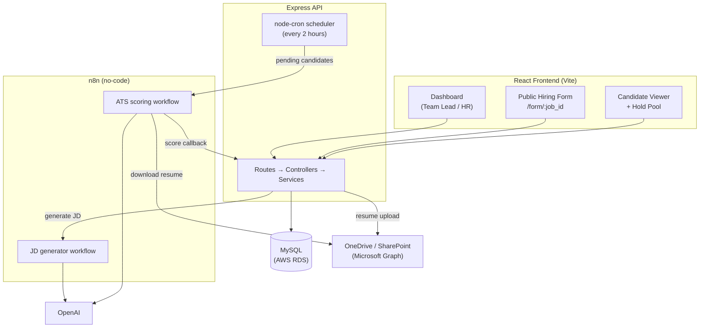
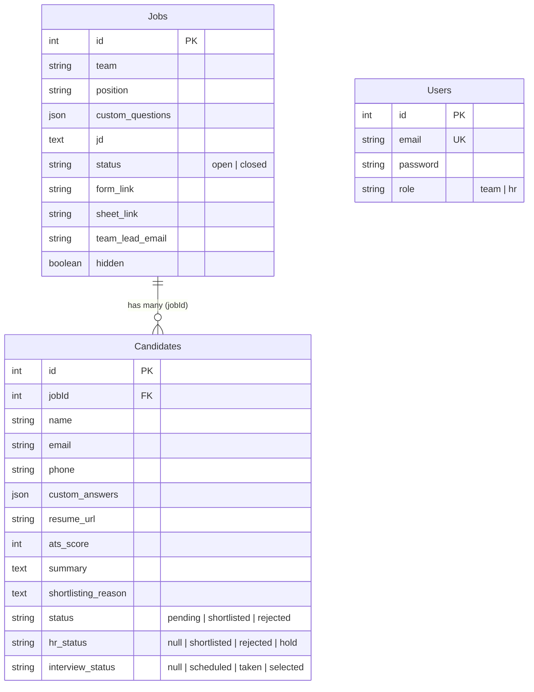
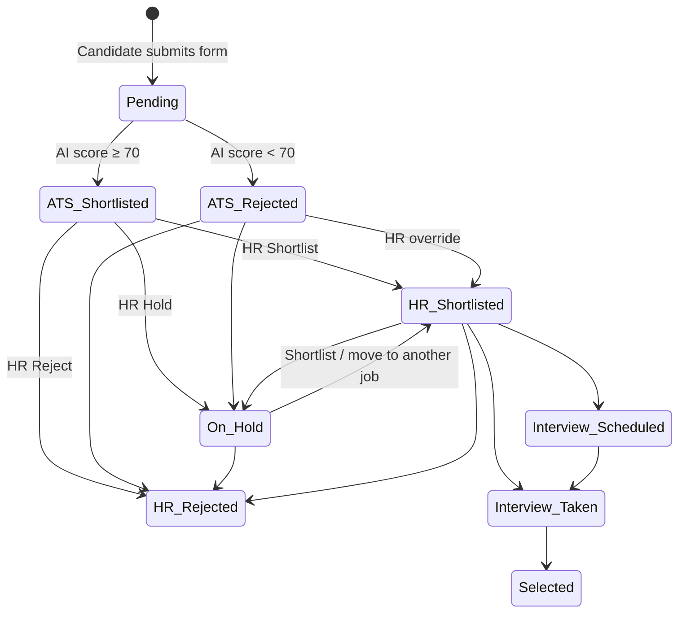
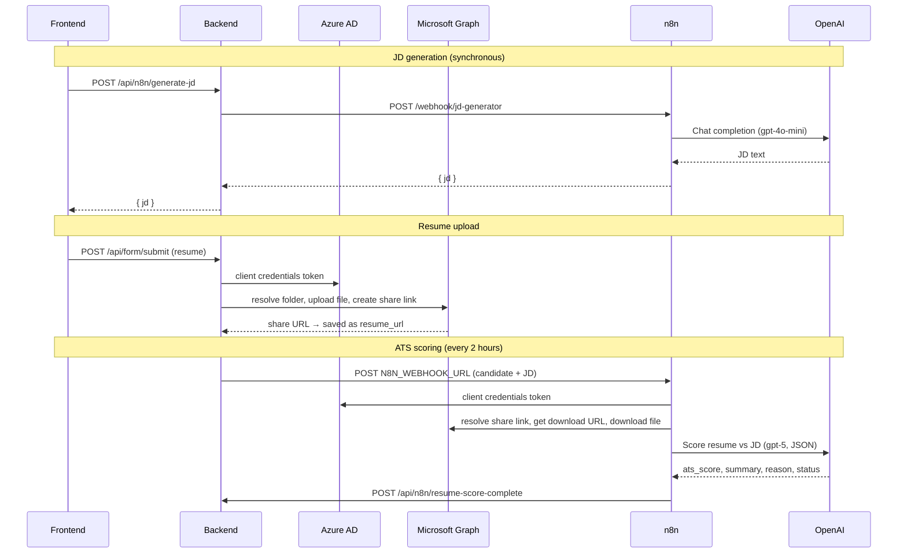

# Recruit Automation — Recruitment Dashboard Technical Documentation

Technical reference for developers and tech staff who maintain or extend the Recruit Automation recruitment dashboard. It covers the purpose of the system, the technology stack, the data model, and the business logic behind every main flow.

---

## Table of Contents

1. [Purpose](#1-purpose)
2. [System Overview](#2-system-overview)
3. [Technology Stack](#3-technology-stack)
4. [Repository Structure](#4-repository-structure)
5. [User Roles and Access](#5-user-roles-and-access)
6. [Data Model](#6-data-model)
7. [Candidate Status Lifecycle](#7-candidate-status-lifecycle)
8. [Flow 1 — Login and Authentication](#8-flow-1--login-and-authentication)
9. [Flow 2 — Job Creation and JD Generation](#9-flow-2--job-creation-and-jd-generation)
10. [Flow 3 — Editing a Job](#10-flow-3--editing-a-job)
11. [Flow 4 — Candidate Application](#11-flow-4--candidate-application)
12. [Flow 5 — Automated ATS Shortlisting (n8n)](#12-flow-5--automated-ats-shortlisting-n8n)
13. [Flow 6 — HR Review in the Candidate Viewer](#13-flow-6--hr-review-in-the-candidate-viewer)
14. [Flow 7 — Hold Pool and Moving Candidates](#14-flow-7--hold-pool-and-moving-candidates)
15. [Flow 8 — Closing and Deleting Jobs](#15-flow-8--closing-and-deleting-jobs)
16. [Backend REST API](#16-backend-rest-api)
17. [Third-Party APIs and Services](#17-third-party-apis-and-services)
18. [Environment Variables](#18-environment-variables)
19. [Local Setup](#19-local-setup)
20. [Deployment](#20-deployment)
21. [Known Limitations and Technical Debt](#21-known-limitations-and-technical-debt)
22. [Further Reading](#22-further-reading)

---

## 1. Purpose

Recruit Automation is an internal HR recruitment tool built for UrbanGabru. It automatically shortlists candidates by comparing each resume against the job description (JD) for the role they applied to.

Without the tool, HR would have to read every resume by hand. With it:

1. A Team Lead creates a job opening and generates the JD with AI.
2. The system produces a public application form for that job.
3. Candidates apply through the form and upload their resume.
4. A background process sends the JD, resume text, and the candidate's answers to an AI scoring workflow built in **n8n**, a no-code automation tool.
5. The AI gives each candidate an ATS score out of 100 and marks them shortlisted (score of 70 or more) or rejected.
6. HR reviews the AI-shortlisted candidates, makes the final decisions, and tracks interviews through to selection.

The scoring pipeline (resume download, text extraction, AI evaluation) runs entirely inside n8n workflows. The application code only queues candidates for scoring and stores the results.

---

## 2. System Overview

The system has four parts:

| Part | Responsibility |
|------|----------------|
| **React frontend** | Dashboard for Team Leads and HR, plus the public application form |
| **Express backend** | REST API, validation, database access, resume upload, scoring scheduler |
| **MySQL database** | Users, jobs, and candidate applications |
| **n8n + OpenAI** | JD generation and resume-vs-JD scoring |

Resumes are stored in **Microsoft OneDrive / SharePoint**, not on the server or in the database.



---

## 3. Technology Stack

### Frontend — `recruitment-dashboard-frontend`

| Technology | Version | Use |
|------------|---------|-----|
| React | 19 | UI |
| Vite | 7 | Dev server and build |
| Tailwind CSS | 4 | Styling (via `@tailwindcss/vite`) |
| react-router-dom | 7 | Client-side routing |
| axios | 1.x | HTTP calls to the backend |
| marked | 18 | Renders markdown on the in-app docs page |
| ESLint | 9 | Linting |

### Backend — `recruitment-dashboard-backend`

| Technology | Version | Use |
|------------|---------|-----|
| Node.js + Express | Express 5 | REST API |
| Sequelize | 6 | ORM for MySQL |
| mysql2 | 3.x | MySQL driver |
| multer | 2.x | Multipart resume upload (in-memory) |
| jsonwebtoken | 9.x | Login tokens |
| node-cron | 4.x | Scheduled ATS scoring batches |
| @azure/msal-node | 3.x | Azure AD client-credentials auth |
| @microsoft/microsoft-graph-client | 3.x | OneDrive uploads and share links |
| axios | 1.x | Outbound calls to n8n |
| dotenv | 17.x | Environment configuration |
| cors, body-parser | — | CORS and JSON parsing |

### Infrastructure and external services

| Service | Use |
|---------|-----|
| MySQL on AWS RDS | Production database (`recruit_db`) |
| Microsoft OneDrive / SharePoint | Resume storage |
| n8n (self-hosted workflow engine) | JD generation and ATS scoring workflows |
| OpenAI | LLM behind both n8n workflows |
| Vercel | Frontend hosting (SPA rewrites in `vercel.json`) |
| PM2 | Backend process manager in production |

---

## 4. Repository Structure

```text
Recruit Automation/
├── recruitment-dashboard-frontend/      # git repo — React app
│   ├── src/
│   │   ├── App.jsx                      # Routes and protected-route wrapper
│   │   ├── pages/
│   │   │   ├── Login.jsx
│   │   │   ├── Dashboard.jsx            # Job create, job listings, close/delete
│   │   │   ├── JDGenerator.jsx          # Calls n8n JD generator through backend
│   │   │   ├── HiringForm.jsx           # Public candidate application form
│   │   │   ├── CandidateViewer.jsx      # HR review tabs per job
│   │   │   ├── HoldPool.jsx             # Held candidates across all jobs
│   │   │   └── Docs.jsx                 # Renders backend documentation
│   │   ├── components/JobEditModal.jsx  # Edit job modal
│   │   ├── constants/teams.js           # Shared list of allowed teams
│   │   └── utils/                       # emailValidator, phoneValidator
│   └── vercel.json
│
├── recruitment-dashboard-backend/       # git repo — Express API
│   ├── server.js                        # App setup, CORS, route mounting, DB sync, cron start
│   ├── routes/                          # auth, jobs, form, candidates, n8n, docs
│   ├── controllers/jobController.js     # HTTP layer for job endpoints
│   ├── services/
│   │   ├── jobService.js                # Job business rules and validation
│   │   └── storage.js                   # OneDrive upload via Microsoft Graph
│   ├── models/                          # Sequelize models: User, Job, Candidate
│   ├── scripts/cronjob.js               # Scheduled ATS scoring dispatcher
│   ├── utils/                           # emailValidator, phoneValidator
│   ├── n8n-flows/                       # Exported n8n workflow JSON files
│   └── documentation/                   # Chapter docs (also served at /docs)
│
└── SQL/                                 # SQL scratch queries + this document
```

Job endpoints follow a routes → controllers → services → models layering. The other route files (`form.js`, `candidates.js`, `n8n.js`, `auth.js`) still keep their logic inside the route handlers.

---

## 5. User Roles and Access

Users are stored in the `Users` table with a `role` of `team` or `hr`. The role is embedded in the login token and read by the frontend to decide what to show.

| Capability | `team` (Team Lead) | `hr` |
|------------|:------------------:|:----:|
| Create a job and generate a JD | Yes | No |
| Edit an open job | Yes | No |
| View job listings and preview JDs | Yes | Yes |
| Open the public form link | Yes | Yes |
| View candidates for a job | No | Yes |
| Close a job's form | No | Yes |
| Use the Hold Pool | No | Yes (button shown to HR only) |
| Delete (hide) a closed job | Yes | Yes |

The public application form (`/form/:job_id`) and the docs page (`/docs`) need no login.

Role checks happen **in the frontend only**. See [Known Limitations](#21-known-limitations-and-technical-debt).

---

## 6. Data Model

Tables are defined as Sequelize models in `models/` and created or updated by `sequelize.sync()` when the server starts. Sequelize adds `createdAt` and `updatedAt` to every table.



### Jobs

| Column | Meaning |
|--------|---------|
| `team` | One of the allowed teams (see `constants/teams.js` / `ALLOWED_TEAMS` in `jobService.js`) |
| `position` | Job title |
| `jd` | Full job description text |
| `custom_questions` | JSON array: `[{ "label": "Question text", "name": "q1" }, ...]` |
| `status` | `open` accepts applications; `closed` disables the form |
| `hidden` | Soft delete. `true` removes the job from the dashboard without deleting data |
| `form_link` | `{FRONTEND_URL}/form/{id}`, generated once at creation |
| `sheet_link` | SharePoint link generated at creation (legacy tracking sheet) |
| `team_lead_email` | Recipient for the "email shortlisted candidates" action |

Allowed teams: Tech, HR, Purchase, Sales, Digital Marketing, Influencer Marketing, Operations, Creative, Video, Content, E-Comm Marketing, Offline Sales.

### Candidates

| Column | Meaning |
|--------|---------|
| `jobId` | Job the candidate applied to (can change via the Hold Pool) |
| `email` | Stored lowercase and trimmed |
| `custom_answers` | JSON object keyed by **question text at the time of applying**, e.g. `{ "Do you know React?": "Yes" }` |
| `resume_url` | OneDrive share link |
| `ats_score`, `summary`, `shortlisting_reason` | Filled in by the n8n scoring callback |
| `status` | AI decision (see below) |
| `hr_status` | HR decision (see below) |
| `interview_status` | Interview progress (see below) |

`custom_answers` is a snapshot. Editing a job's questions later never changes answers already submitted.

---

## 7. Candidate Status Lifecycle

Each candidate carries three independent status fields:

| Field | Set by | Values |
|-------|--------|--------|
| `status` | System / AI | `pending` on submit, then `shortlisted` or `rejected` after scoring |
| `hr_status` | HR | `null` (not reviewed), `shortlisted`, `rejected`, `hold` |
| `interview_status` | HR | `null`, `scheduled`, `taken`, `selected` |



---

## 8. Flow 1 — Login and Authentication

**Files:** `routes/auth.js`, `pages/Login.jsx`, `App.jsx`

1. The user submits email and password to `POST /api/auth/login`.
2. The backend looks up the user by email and compares the password directly.
3. On success it signs a JWT containing `{ id, role }` and returns `{ token }`.
4. The frontend decodes the token payload, stores `{ token, role }` in `localStorage` under `user`, and redirects to `/dashboard`.
5. `ProtectedRoute` in `App.jsx` sends users without a stored session back to the login page.
6. Logout clears `localStorage`.

There is no sign-up page. Accounts are created directly in the `Users` table.

---

## 9. Flow 2 — Job Creation and JD Generation

**Files:** `pages/Dashboard.jsx`, `pages/JDGenerator.jsx`, `routes/n8n.js`, `services/jobService.js`

Only `team` users see the job creation form.

### Step 1 — Generate the JD

1. The Team Lead selects a team and enters the position title.
2. In the JD generator they enter key responsibilities, required skills, and experience.
3. The frontend calls `POST /api/n8n/generate-jd`.
4. The backend forwards the input to the n8n JD generator webhook, which uses OpenAI to write the JD.
5. The backend accepts several response shapes from n8n (plain string, `{ jd }`, or `[{ payload: { jd } }]`) and returns `{ jd }`.
6. The JD appears in an editable textarea, so the Team Lead can adjust it or paste their own.

### Step 2 — Add custom questions and create the job

1. The Team Lead adds one or more custom screening questions and the team lead email.
2. **Create Job** calls `POST /api/jobs/create`.
3. `jobService.validateJobPayload` checks:
   - team is in the allowed list
   - position is at least 2 characters
   - JD is at least 20 characters
   - team lead email passes `validateEmail`
   - at least one non-empty question exists
   - question labels are unique (case-insensitive)
4. Questions are normalized: blank ones are dropped and names are renumbered `q1`, `q2`, ...
5. The job is saved with `status = open` and `hidden = false`.
6. `form_link` is set to `{first FRONTEND_URL}/form/{job.id}`, and `sheet_link` is generated.
7. The dashboard shows the form link and refreshes the job list.

---

## 10. Flow 3 — Editing a Job

**Files:** `components/JobEditModal.jsx`, `controllers/jobController.js`, `services/jobService.js`, `routes/jobs.js`

Team Leads can edit a job after creation using the **Edit** button in the open jobs table.

### Rules

| Rule | Reason |
|------|--------|
| Only `open`, non-hidden jobs can be edited | Closed and deleted jobs are finished records |
| `team` and `position` cannot change (read-only in the UI and ignored by the backend) | Keeps the job's identity stable and avoids breaking Hold Pool matching, which groups jobs by team |
| `id`, `form_link`, `sheet_link`, `status`, `hidden` are never changed by edit | The public form URL stays the same |
| Editable: `jd`, `custom_questions` (add, rename, remove), `team_lead_email` | — |
| Same validation as creation | — |

### Effect on existing applicants

- Past answers are **not** rewritten. They keep showing under the original question text in the Candidate Viewer.
- New applicants see the updated questions the next time the form page loads.
- Candidates still waiting for scoring are scored against the **updated** JD, because the cron job reads the job's current JD at scoring time. Candidates already scored keep their existing scores.

### Request

`PUT /api/jobs/:id` with `{ jd, custom_questions, team_lead_email }` (team and position may be sent but are ignored). The response is `{ job, applicant_count, questions_locked }`.

---

## 11. Flow 4 — Candidate Application

**Files:** `pages/HiringForm.jsx`, `routes/form.js`, `services/storage.js`, `utils/emailValidator.js`, `utils/phoneValidator.js`

### Loading the form

1. The candidate opens `/form/:job_id` (no login required).
2. The page calls `GET /api/jobs/:job_id`.
3. If the job is `closed`, the page shows that applications are closed.
4. Otherwise it renders name, email, phone, the job's custom questions, a fixed **"Willing to relocate to Pune?"** question, and a resume upload field.
5. The page blocks right-click, F12, and common DevTools / view-source shortcuts. This is a deterrent only, not a security control.

### Validation while typing

- **Email** — `validateEmail` checks format, blocks placeholder domains (`example.com`, `test.com`, ...), suggests fixes for typos (`gmail.con` → `gmail.com`), checks the domain extension, and only accepts known providers or plausible company domains.
- **Duplicate check** — once the email is valid, the page calls `POST /api/form/check-duplicate` and warns if this email or phone number has already applied to this job.
- **Phone** — `validatePhoneNumber` requires 7–15 digits.
- **Resume** — PDF, DOC, or DOCX only, maximum 2 MB.

### Submitting

The form posts multipart data to `POST /api/form/submit`:

| Field | Content |
|-------|---------|
| `name`, `email`, `phone` | Candidate details |
| `job_id`, `team`, `position` | Job context |
| `custom_<question text>` | One field per custom question |
| `custom_Willing to relocate to Pune` | Relocation answer |
| `resume` | File |

The backend then:

1. Rejects missing files, wrong file types (400), and files over 2 MB (413).
2. Validates email and phone again on the server.
3. Rejects duplicates for the same job (409):
   - by lowercase email, or
   - by **normalized** phone number. Normalization strips formatting and the Indian `+91` / `91` prefix, so `+91 98765-43210` and `9876543210` count as the same number.
4. Renames the resume to `{name}-{position}-{YYYYMMDDHHmmss}.{ext}`.
5. Uploads it to OneDrive (see below). If the upload fails, it returns 502 and **does not** create the candidate.
6. Builds `custom_answers` from every `custom_*` field.
7. Creates the candidate with `status = pending`.

### OneDrive upload (`services/storage.js`)

1. Gets an app-only access token from Azure AD using client credentials (`MS_CLIENT_ID`, `MS_CLIENT_SECRET`, `MS_TENANT_ID`).
2. Resolves the target folder from the shared folder link in `NEW_SHARE_LINK` via the Graph `/shares` API.
3. Uploads the file into that folder.
4. Tries to create an anonymous view link. If tenant policy blocks that, it falls back to the item's organization-visible `webUrl`.
5. Returns the link, which is stored as `resume_url`.

---

## 12. Flow 5 — Automated ATS Shortlisting (n8n)

**Files:** `scripts/cronjob.js`, `routes/n8n.js`, `n8n-flows/Recruit Automation 2.0.json`

This is the core shortlisting logic. It runs in the background so candidates don't wait for scoring when they apply.

### Step 1 — Dispatch (backend cron)

`scripts/cronjob.js` is loaded by `server.js` and runs on the schedule `0 */2 * * *` (every 2 hours, on the hour).

On each run it:

1. Finds up to **10** candidates where `ats_score` is null and `status = pending`.
2. Skips candidates whose job no longer exists or whose `resume_url` isn't an http(s) link.
3. Posts each remaining candidate to `N8N_WEBHOOK_URL`:

```json
{
  "candidate_id": 123,
  "resume_url": "https://...sharepoint.com/...",
  "jd": "Current job description text",
  "name": "Jane Doe",
  "email": "jane@example.com",
  "willing_to_relocate": "Yes",
  "custom_answers": { "Do you know React?": "Yes" }
}
```

At most 10 candidates are sent per run, so a large backlog takes several runs to clear.

### Step 2 — Scoring (n8n workflow)

The n8n workflow, built with no-code nodes:

1. Receives the webhook payload.
2. Gets a Microsoft Graph token.
3. Converts the OneDrive share link into a Graph share ID.
4. Resolves the file and gets a temporary download URL.
5. Downloads the resume.
6. Extracts text from the file. The extractor is configured for **PDF only, first 2 pages**. DOC/DOCX resumes produce no text, and the workflow continues anyway.
7. Sends the JD, resume text, relocation answer, and custom answers to OpenAI (model `gpt-5`, JSON output) with an ATS-evaluator prompt.
8. OpenAI returns:
   - `ats_score` — 0 to 100
   - `summary` — one or two sentences on the candidate
   - `reason` — exactly two sentences: strengths, then gaps
   - `status` — `shortlisted` if the score is 70 or more, otherwise `rejected`

The prompt also tells the model to treat one-word or all-"Yes" custom answers as weak evidence.

### Step 3 — Callback (backend)

n8n calls `POST /api/n8n/resume-score-complete` with `candidate_id`, `email`, `ats_score`, `summary`, `reason`, and `status`. The callback URL is hardcoded in the workflow to the **production** backend (see [n8n ATS scoring workflow](#174-n8n--ats-scoring-workflow)).

The backend:

1. Requires `status`, plus `candidate_id` or `email`.
2. Finds the candidate by `candidate_id`. Email lookup is a legacy fallback and only updates the first match.
3. Saves `ats_score`, `summary`, `shortlisting_reason`, and `status`.

The candidate then appears in the matching Candidate Viewer tab.

---

## 13. Flow 6 — HR Review in the Candidate Viewer

**Files:** `pages/CandidateViewer.jsx`, `routes/form.js`

HR opens `/candidates/:job_id` from **View Candidates**. The page loads the job and all its candidates with `GET /api/jobs/:id`, then sorts them into tabs:

| Tab | Rule | HR actions |
|-----|------|------------|
| Pending Review (ATS Shortlisted) | `status = shortlisted` and no `hr_status` | Shortlist, Hold, Reject |
| HR Shortlisted | `hr_status = shortlisted` and not selected | Interview actions, Reject, Hold |
| Selected | `interview_status = selected` | View only |
| On Hold | `hr_status = hold` | Shortlist, Reject |
| HR Rejected | `hr_status = rejected` | View only |
| ATS Rejected | `status = rejected` and no `hr_status` | Shortlist, Hold, Reject (HR can override the AI) |

Candidates still waiting for scoring (`status = pending`) don't appear in any tab until n8n scores them.

### Actions

- **Shortlist / Hold / Reject** → `POST /api/form/update-status/:id` with `{ hr_status }`. HR is asked to confirm first.
- **Interview progress** on HR Shortlisted candidates → `POST /api/form/update-interview-status/:id`:
  - no interview status yet: **Schedule** or **Mark Taken**
  - `scheduled`: **Mark Taken**
  - `taken`: **Selected**
  - The backend only accepts `scheduled`, `taken`, or `selected`.
- **Email Team Lead** opens a `mailto:` draft to the job's `team_lead_email` listing every HR-shortlisted candidate with score, summary, resume link, and reason.

### Viewing tools

- Search by name or email.
- Filter by submission date: all, today, last 7 days, last 30 days, this month (calculated in IST).
- Sort by ATS score (high→low default, or low→high) or by name (A→Z, Z→A).
- Responsive carousel: 1, 2, or 3 cards per view depending on screen width.
- Expandable cards for long summaries, reasons, and custom answers.
- A "last ATS scoring" timestamp from `GET /api/form/latest-ats-timestamp`, which is the most recent `updatedAt` of any scored candidate across all jobs.

---

## 14. Flow 7 — Hold Pool and Moving Candidates

**Files:** `pages/HoldPool.jsx`, `routes/candidates.js`

The Hold Pool lets HR reuse promising candidates for other openings in the same team.

1. HR opens `/hold-pool` from the dashboard.
2. The page loads every held candidate across all jobs (`GET /api/candidates/held`), each with their original team, position, and job status.
3. It loads open, non-hidden jobs and groups them by team.
4. HR can filter held candidates by team.
5. For each candidate, HR picks an open job **in the same team** and confirms the move.
6. `POST /api/candidates/move-to-job` with `{ candidateId, newJobId, hr_status: "shortlisted" }`:
   - Returns 404 if the candidate or target job doesn't exist.
   - Returns 400 if the target job is in a different team.
   - Otherwise updates the candidate's `jobId` and sets `hr_status = shortlisted`.

The candidate keeps their original ATS score, summary, and answers. They are not re-scored against the new job's JD.

---

## 15. Flow 8 — Closing and Deleting Jobs

**Files:** `pages/Dashboard.jsx`, `services/jobService.js`

| Action | Who | Endpoint | Effect |
|--------|-----|----------|--------|
| Close Form | HR | `POST /api/jobs/close/:id` | Sets `status = closed`. The public form stops accepting applications. There is no reopen in the UI. |
| Delete Job | Any logged-in user, closed jobs only | `POST /api/jobs/hide/:id` | Sets `hidden = true`. The job disappears from the dashboard, but the job and its candidates stay in the database. |
| Unhide | API only | `POST /api/jobs/unhide/:id` | Sets `hidden = false`. |

The dashboard shows open jobs first and closed jobs in a collapsible section. Nothing is ever hard-deleted.

---

## 16. Backend REST API

This section documents every endpoint the Express backend exposes: who calls it, what it expects, and what it returns.

### 16.1 Conventions

| Topic | Behavior |
|-------|----------|
| Base URL | Frontend reads it from `VITE_BACKEND_URL`. Local default `http://localhost:3004`. |
| Format | JSON request and response bodies, except `POST /api/form/submit`, which is `multipart/form-data`. |
| Errors | JSON `{ "error": "message" }` with a 4xx/5xx status. Some validation errors add extra fields such as `suggestion`, `isEmailInvalid`, `isPhoneInvalid`, `isDuplicate`. |
| Authentication | **None enforced.** The frontend sends `Authorization: Bearer <token>` on some calls (create, edit, close, hide), but no route checks it. |
| CORS | Browser requests are allowed only from origins listed in `FRONTEND_URL`. Requests with no `Origin` header (servers, curl, n8n) are always allowed. |
| Route mounting | `server.js` mounts `/api/auth`, `/api/jobs`, `/api/form`, `/api/n8n`, `/api/candidates`, `/api/docs`. `GET /` returns a plain-text health message. |

### 16.2 Endpoint summary

| Method | Path | Called by | Purpose |
|--------|------|-----------|---------|
| POST | `/api/auth/login` | Login page | Get a login token |
| GET | `/api/jobs` | Dashboard, Hold Pool | List non-hidden jobs |
| GET | `/api/jobs/all` | Not used by UI | List all jobs |
| GET | `/api/jobs/:id` | Hiring form, Candidate Viewer, Edit modal | One job and its candidates |
| POST | `/api/jobs/create` | Dashboard | Create a job |
| PUT | `/api/jobs/:id` | Edit modal | Edit a job |
| POST | `/api/jobs/close/:id` | Dashboard (HR) | Close the form |
| POST | `/api/jobs/hide/:id` | Dashboard | Soft-delete a closed job |
| POST | `/api/jobs/unhide/:id` | Not used by UI | Restore a hidden job |
| POST | `/api/form/check-duplicate` | Hiring form | Duplicate application check |
| POST | `/api/form/submit` | Hiring form | Submit an application |
| POST | `/api/form/update-status/:id` | Candidate Viewer | HR decision |
| POST | `/api/form/update-interview-status/:id` | Candidate Viewer | Interview progress |
| GET | `/api/form/latest-ats-timestamp` | Candidate Viewer | Last scoring time |
| GET | `/api/candidates/held` | Hold Pool | Held candidates |
| GET | `/api/candidates/available-jobs/:team` | Not used by UI | Open jobs in a team |
| POST | `/api/candidates/move-to-job` | Hold Pool | Move a held candidate |
| GET | `/api/candidates/by-team/:team` | Not used by UI | Candidates for a team |
| POST | `/api/n8n/generate-jd` | JD generator | Generate a JD through n8n |
| POST | `/api/n8n/resume-score-complete` | **n8n** scoring workflow | Save an ATS score |
| POST | `/api/n8n/jd-complete` | Not used | Logs a JD from n8n |
| GET | `/api/docs` | Docs page | List doc chapters |
| GET | `/api/docs/:slug` | Docs page | One doc chapter |

### 16.3 Auth

#### `POST /api/auth/login`

Request:

```json
{ "email": "user@urbangabru.in", "password": "..." }
```

| Status | Response |
|--------|----------|
| 200 | `{ "token": "<JWT>" }`. The token payload is `{ id, role }`. No expiry is set. |
| 401 | `{ "error": "Invalid credentials" }` |

### 16.4 Jobs

Job endpoints go through `controllers/jobController.js` → `services/jobService.js`. Service errors carry their own status code, and the controller returns `{ error }` with that status (500 if none).

#### `GET /api/jobs` and `GET /api/jobs/all`

Return an array of job objects. `/api/jobs` excludes `hidden = true`; `/all` includes them.

```json
[
  {
    "id": 2,
    "team": "Video",
    "position": "Video content lead",
    "custom_questions": [{ "label": "Kindly share your portfolio link", "name": "q1" }],
    "jd": "...",
    "status": "open",
    "sheet_link": "https://...",
    "form_link": "https://<frontend>/form/2",
    "team_lead_email": "lead@urbangabru.in",
    "hidden": false,
    "createdAt": "...",
    "updatedAt": "..."
  }
]
```

#### `GET /api/jobs/:id`

| Status | Response |
|--------|----------|
| 200 | `{ "job": {...}, "candidates": [...], "applicant_count": 61, "questions_locked": false }` |
| 404 | `{ "error": "Job not found." }` |

`candidates` contains every candidate for the job, including all status fields. This endpoint is public because the hiring form uses it, so it also exposes candidate data to anyone with a job ID (see [Known Limitations](#21-known-limitations-and-technical-debt)).

#### `POST /api/jobs/create`

Request:

```json
{
  "team": "Tech",
  "position": "Frontend Developer",
  "jd": "Full job description (20+ characters)",
  "custom_questions": [{ "label": "Do you know React?", "name": "q1" }],
  "team_lead_email": "lead@urbangabru.in"
}
```

| Status | Response |
|--------|----------|
| 200 | The created job, including generated `form_link` and `sheet_link` |
| 400 | One of: `Please select a valid team.`, `Position title is required.`, `Job description is missing or incomplete.`, an email validation message, `Please add at least one custom question.`, `Custom question labels must be unique.` |

#### `PUT /api/jobs/:id`

Request: same shape as create. `team` and `position` are ignored; the stored values are kept.

| Status | Response |
|--------|----------|
| 200 | `{ "job": {...}, "applicant_count": 61, "questions_locked": false }` |
| 400 | `Hidden jobs cannot be edited.`, `Only open jobs can be edited. ...`, or a validation message |
| 404 | `{ "error": "Job not found." }` |

#### `POST /api/jobs/close/:id`, `/hide/:id`, `/unhide/:id`

No body.

| Endpoint | 200 response | Error |
|----------|--------------|-------|
| `close` | `{ "success": true }` | 404 `Job not found.` |
| `hide` | `{ "success": true, "message": "Job hidden successfully" }` | 404 |
| `unhide` | `{ "success": true, "message": "Job unhidden successfully" }` | 404 |

### 16.5 Application form and HR status

#### `POST /api/form/check-duplicate`

Request:

```json
{ "email": "jane@gmail.com", "phone": "+91 98765 43210", "job_id": 2 }
```

| Status | Response |
|--------|----------|
| 200 | `{ "isDuplicate": false }` |
| 200 | `{ "isDuplicate": true, "duplicateType": "email", "appliedDate": "...", "candidateName": "..." }` |
| 200 | `{ "isDuplicate": true, "duplicateType": "phone", "appliedDate": "...", "candidateName": "...", "message": "..." }` |
| 400 | `Email and job_id are required`, or `{ error, suggestion, isEmailInvalid: true }` |

Phone is compared after normalization (digits only, Indian `+91`/`91` prefix removed). The phone check runs first.

#### `POST /api/form/submit`

`multipart/form-data` fields:

| Field | Required | Notes |
|-------|:--------:|-------|
| `resume` | Yes | PDF, DOC, or DOCX, max 2 MB |
| `name`, `email`, `phone` | Yes | Validated server-side |
| `job_id` | Yes | Target job |
| `team`, `position` | Yes | Used in the resume file name |
| `custom_<question text>` | Per question | Stored in `custom_answers` under the question text |
| `custom_Willing to relocate to Pune` | Yes (UI) | Read by the scoring cron |

| Status | Response |
|--------|----------|
| 200 | `{ "success": true, "resume_url": "https://...sharepoint.com/..." }` |
| 400 | No file, wrong file type, invalid email (`isEmailInvalid`), invalid phone (`isPhoneInvalid`) |
| 409 | Already applied with this email or phone (`isDuplicate`, `duplicateType`, `appliedDate`) |
| 413 | `File too large. Max allowed size is 2 MB.` |
| 502 | `Resume upload failed. Please try again.` (OneDrive upload failed; no candidate is created) |
| 500 | `Submission failed` |

#### `POST /api/form/update-status/:id`

Request: `{ "hr_status": "shortlisted" | "rejected" | "hold" }`. A `status` field is also accepted and overwrites the AI status. Values are **not** validated.

| Status | Response |
|--------|----------|
| 200 | `{ "success": true }` |
| 404 | `Candidate not found` |

#### `POST /api/form/update-interview-status/:id`

Request: `{ "interview_status": "scheduled" | "taken" | "selected" }`

| Status | Response |
|--------|----------|
| 200 | `{ "success": true, "message": "...", "candidate": { "id", "name", "interview_status" } }` |
| 400 | Invalid interview status |
| 404 | `Candidate not found` |

#### `GET /api/form/latest-ats-timestamp`

Returns `{ "timestamp": "<ISO date>" }` for the most recently scored candidate across all jobs, or `{ "timestamp": null }`.

### 16.6 Hold Pool

#### `GET /api/candidates/held`

Array of candidates with `hr_status = hold`, newest first. Each item includes the full candidate, a nested `job`, plus `originalTeam`, `originalPosition`, `originalJobId`, `originalJobStatus`.

#### `GET /api/candidates/available-jobs/:team`

Array of `{ id, team, position, status, form_link }` for open, non-hidden jobs in the team, newest first.

#### `POST /api/candidates/move-to-job`

Request:

```json
{ "candidateId": 12, "newJobId": 4, "hr_status": "shortlisted" }
```

`hr_status` defaults to `shortlisted`.

| Status | Response |
|--------|----------|
| 200 | `{ "success": true, "message": "...", "candidate": { "id", "name", "email", "newJobId", "newJobPosition", "hr_status" } }` |
| 400 | Missing IDs, or `Cannot move candidate to a different team` |
| 404 | Candidate or target job not found |

#### `GET /api/candidates/by-team/:team`

All candidates whose job belongs to the team, with the job nested.

### 16.7 n8n integration endpoints

#### `POST /api/n8n/generate-jd`

Called by the JD generator. The backend forwards the body to the n8n JD workflow and normalizes the reply.

Request:

```json
{
  "team": "Tech",
  "position": "Frontend Developer",
  "responsibilities": "...",
  "skills": "...",
  "experience": "2+ years",
  "location": "optional, not sent by the UI"
}
```

| Status | Response |
|--------|----------|
| 200 | `{ "jd": "Generated job description" }` |
| 500 | `{ "error": "Failed to generate JD" }` (n8n unreachable or reply had no JD) |

Accepted n8n reply shapes: a plain string, `{ "jd": "..." }`, or `[{ "payload": { "jd": "..." } }]`.

#### `POST /api/n8n/resume-score-complete`

Called by the n8n scoring workflow, not by the frontend.

Request:

```json
{
  "candidate_id": 123,
  "email": "jane@gmail.com",
  "ats_score": 82,
  "summary": "One or two sentences.",
  "reason": "Strengths sentence. Gaps sentence.",
  "status": "shortlisted"
}
```

| Status | Response |
|--------|----------|
| 200 | `{ "success": true, "candidateId": 123, "email": "...", "status": "shortlisted" }` |
| 400 | `candidate_id or email is required`, or `status is required` |
| 404 | Candidate not found |

Updates `ats_score`, `summary`, `shortlisting_reason` (from `reason`), and `status`. If `candidate_id` is missing, it falls back to the first candidate with that email.

#### `POST /api/n8n/jd-complete`

Accepts `{ team, position, jd }`, logs it, and returns `{ "success": true }`. Nothing is saved. Not called by the current workflows.

### 16.8 Docs

| Endpoint | Response |
|----------|----------|
| `GET /api/docs` | `[{ "slug": "01_project_overview", "title": "...", "order": 1 }, ...]` built from `documentation/NN_name.md` files |
| `GET /api/docs/:slug` | `{ "slug", "title", "content", "updatedAt" }`. 400 for an invalid slug (path traversal guard), 404 if missing. |

---

## 17. Third-Party APIs and Services

The product depends on four external services. Only Microsoft and n8n are called from our code. OpenAI is called only from inside n8n.

### 17.1 Overview

| Service | Called from | Used for | Auth | Configured in |
|---------|-------------|----------|------|---------------|
| Microsoft identity platform (Azure AD) | Backend `services/storage.js`, n8n scoring workflow, migration script | App-only access tokens for Microsoft Graph | OAuth 2.0 client credentials (client ID + secret) | Backend: `MS_CLIENT_ID`, `MS_CLIENT_SECRET`, `MS_TENANT_ID`. n8n: values typed into the token HTTP node. |
| Microsoft Graph API v1.0 | Backend, n8n scoring workflow, migration script | Upload resumes, create share links, download resumes | Bearer token from Azure AD | `NEW_SHARE_LINK` (target folder) |
| n8n | Backend (`routes/n8n.js`, `scripts/cronjob.js`) | JD generation and ATS scoring workflows | None. Webhook URLs are unauthenticated. | JD URL hardcoded in `routes/n8n.js`; scoring URL in `N8N_WEBHOOK_URL` |
| OpenAI | n8n only | Writing JDs and scoring resumes | API key stored as the n8n credential "OpenAi account" | n8n credentials |



### 17.2 Microsoft identity platform (Azure AD)

Both the backend and n8n authenticate as an Azure AD **app registration**, not as a user.

- **Flow:** OAuth 2.0 client credentials.
- **Token endpoint:** `https://login.microsoftonline.com/{tenant-id}/oauth2/v2.0/token`
- **Scope:** `https://graph.microsoft.com/.default`
- **Backend:** uses `@azure/msal-node` (`ConfidentialClientApplication.acquireTokenByClientCredential`) on every upload. MSAL caches tokens in memory.
- **n8n:** posts directly to the token endpoint with `client_id`, `client_secret`, `scope`, and `grant_type=client_credentials` as form fields.
- **Permissions:** the app needs Graph **application** permissions that allow reading and writing files in the target OneDrive/SharePoint location (typically `Files.ReadWrite.All` or `Sites.ReadWrite.All`, with admin consent). Confirm the exact grants in the Azure portal before changing anything.

If the client secret expires or is rotated, update it in **both** the backend `.env` and the n8n token node. Otherwise uploads fail with 502 on the form, and scoring stops.

### 17.3 Microsoft Graph API

Base URL: `https://graph.microsoft.com/v1.0`

#### Used by the backend — resume upload (`services/storage.js`)

| Step | Request | Purpose |
|------|---------|---------|
| 1 | `GET /shares/u!{base64url(NEW_SHARE_LINK)}?$expand=driveItem` | Turn the shared folder link into a `driveId` and folder `id` |
| 2 | `PUT /drives/{driveId}/items/{folderId}:/{fileName}:/content` | Upload the resume (simple upload, fine for the 2 MB cap) |
| 3 | `POST /drives/{driveId}/items/{itemId}/createLink` with `{ "type": "view", "scope": "anonymous" }` | Create a view-only share link |

If step 3 is blocked by tenant sharing policy, the backend falls back to the item's `webUrl`, which only people in the organization can open. If any step fails, `uploadToOneDrive` returns `null` and the form returns 502.

Share links are encoded as `u!` + base64url (`+`→`-`, `/`→`_`, padding removed), as Graph's shares API requires.

#### Used by n8n — resume download (scoring workflow)

| Step | Request | Purpose |
|------|---------|---------|
| 1 | `GET /shares/u!{base64url(resume_url)}/driveItem` | Resolve the candidate's resume link to a file |
| 2 | `GET /drives/{driveId}/items/{itemId}?select=@microsoft.graph.downloadUrl` | Get a short-lived, pre-authenticated download URL |
| 3 | `GET {downloadUrl}` | Download the file as binary (no auth header needed) |

#### Used by the migration script (`services/migrate-onedrive-resumes.js`)

A one-time script that moved resumes from an old OneDrive folder (`OLD_SHARE_LINK`) to the current one (`NEW_SHARE_LINK`). It lists folder children with paging (`@odata.nextLink`), copies each file (`POST /drives/{id}/items/{id}/copy`), creates new anonymous links, and rewrites `Candidates.resume_url`. It is not part of normal operation.

### 17.4 n8n — ATS scoring workflow

Exported as `n8n-flows/Recruit Automation 2.0.json`.

| Item | Value |
|------|-------|
| Trigger | Webhook, `POST /webhook/ats-score` (URL set in `N8N_WEBHOOK_URL`) |
| Caller | `scripts/cronjob.js`, one request per candidate |
| Response mode | Responds when the **last node finishes**, so each cron request waits for the full scoring run |
| Input | `candidate_id`, `resume_url`, `jd`, `name`, `email`, `willing_to_relocate`, `custom_answers` |
| Output | HTTP callback to the backend's `/api/n8n/resume-score-complete` |

Nodes in order:

1. **Webhook** — receives the candidate.
2. **HTTP Request (token)** — Azure AD client credentials token.
3. **Code** — encodes `resume_url` as a Graph share ID.
4. **HTTP Request** — Graph: resolve drive item.
5. **HTTP Request** — Graph: get download URL.
6. **HTTP Request** — download the file.
7. **Extract from File** — operation `pdf`, max 2 pages. Errors are ignored and the run continues.
8. **OpenAI** — model `gpt-5`, JSON output, retry on failure, errors ignored.
9. **HTTP Request (callback)** — posts the result to the backend.

Things to know:

- **The callback URL is hardcoded to the production backend.** When testing locally, scores still go to production, which updates whichever production candidate has that `candidate_id`.
- **The callback body is built by string templating.** A double quote or line break in the AI's `summary` or `reason` produces invalid JSON, so the callback fails and the candidate stays `pending`.
- **Failures are silent.** If extraction or OpenAI fails, the callback sends incomplete data, the backend rejects it, and the candidate is retried on the next cron run.
- The cron uses axios with no timeout, so a stuck workflow holds up the rest of that batch.

### 17.5 n8n — JD generator workflow

Exported as `n8n-flows/Recruit Automation 1.0.json`.

| Item | Value |
|------|-------|
| Trigger | Webhook, `POST /webhook/jd-generator` |
| Caller | Backend `POST /api/n8n/generate-jd` (URL hardcoded in `routes/n8n.js`) |
| Response mode | "Respond to Webhook" node, returns `{ "jd": "..." }` |
| Model | OpenAI `gpt-4o-mini` (chat) |

Nodes: **Webhook** → **OpenAI** → **Code** (strips markdown asterisks, trims lines, escapes newlines) → **Respond to Webhook**.

The prompt adds company boilerplate for UrbanGabru and UrbanYog, a "must relocate to Pune" note, and formatting rules so the JD can be pasted into LinkedIn. It uses `team`, `position`, `responsibilities`, `skills`, and `experience`. `location` is passed through but not used in the prompt.

### 17.6 OpenAI

OpenAI is never called from our backend or frontend. Both uses happen inside n8n with the shared n8n credential "OpenAi account".

| Use | Workflow | Model | Output |
|-----|----------|-------|--------|
| Write a JD | JD generator | `gpt-4o-mini` | Plain JD text |
| Score a resume | ATS scoring | `gpt-5` | JSON: `ats_score`, `summary`, `reason`, `status` |

Scoring rules enforced by the prompt:

- `status` is `shortlisted` only when the candidate fits the role **and** `ats_score` is 70 or more. Otherwise `rejected` with a score below 70.
- `reason` is exactly two sentences: strengths, then gaps.
- One-word or "Yes"-only custom answers count as weak evidence.
- Relocation willingness is part of the evaluation.

Cost and rate limits are governed by the OpenAI account connected to n8n. Each scored candidate is one `gpt-5` request; each generated JD is one `gpt-4o-mini` request.

### 17.7 Unused third-party packages

| Package | Status |
|---------|--------|
| `googleapis`, `google-auth-library` | Left over from an earlier Google Drive upload (`services/storage-old.js` and commented code in `routes/auth.js`). Not used at runtime and safe to remove once confirmed. |

---

## 18. Environment Variables

Never commit real values. Keep them in `.env` files that are excluded from git.

### Backend — `recruitment-dashboard-backend/.env`

| Variable | Purpose |
|----------|---------|
| `DB_HOST`, `DB_PORT`, `DB_NAME`, `DB_USER`, `DB_PASSWORD` | MySQL connection |
| `DB_DIALECT` | `mysql` |
| `PORT` | API port (defaults to `3004`) |
| `FRONTEND_URL` | Comma-separated allowed CORS origins. The **first** entry is used to build new `form_link`s. |
| `MS_CLIENT_ID`, `MS_CLIENT_SECRET`, `MS_TENANT_ID` | Azure AD app for Microsoft Graph |
| `NEW_SHARE_LINK` | Shared link of the OneDrive / SharePoint folder that receives resumes |
| `N8N_WEBHOOK_URL` | n8n ATS scoring webhook used by the cron job |

The n8n JD generator URL is hardcoded in `routes/n8n.js`, not read from `.env`.

### Frontend — `recruitment-dashboard-frontend/.env`

| Variable | Purpose |
|----------|---------|
| `VITE_BACKEND_URL` | Backend base URL |

---

## 19. Local Setup

**Prerequisites:** Node.js LTS, access to a MySQL database, and the `.env` values from the team.

```bash
# Backend
cd recruitment-dashboard-backend
npm install
npm start            # http://localhost:3004

# Frontend (new terminal)
cd recruitment-dashboard-frontend
npm install
npm run dev          # http://localhost:5173
```

On startup the backend runs `sequelize.sync()` to create missing tables and starts the scoring cron.

Smoke test:

1. Log in with a `team` user and create a job.
2. Open the form link and submit a test application with a small PDF.
3. Check the resume appears in the OneDrive folder and a `Candidates` row exists with `status = pending`.
4. Wait for the next cron run (or temporarily change the schedule in `cronjob.js` to `*/1 * * * *` while testing), then confirm the score arrives.
5. Log in as `hr` and review the candidate in the Candidate Viewer.

Useful SQL (see `SQL/Recruit Automation.sql`):

```sql
USE recruit_db;
SELECT * FROM Users;
SELECT * FROM Jobs;
SELECT * FROM Candidates;
```

---

## 20. Deployment

| Component | How |
|-----------|-----|
| Frontend | Vite build deployed to Vercel. `vercel.json` rewrites every path to `/` so React Router handles deep links such as `/form/12`. |
| Backend | Node server managed by PM2: `npm run start:prod` (first start), `npm run deploy:prod` (restart). |
| Database | MySQL on AWS RDS |

When the frontend domain changes, update `FRONTEND_URL` on the backend so CORS allows it and new form links use the new domain. Existing jobs keep their old stored `form_link`.

---

## 21. Known Limitations and Technical Debt

Things to be aware of when maintaining or extending the system:

| Area | Current behavior | Risk / suggestion |
|------|------------------|-------------------|
| API authorization | The backend doesn't verify the JWT on any route. Role checks exist only in the frontend. | Anyone who can reach the API can call it directly. Add auth middleware and role checks on protected routes. |
| Public candidate data | `GET /api/jobs/:id` is public (the form needs it) and returns every candidate for the job. `check-duplicate` returns the earlier applicant's name. | Return only job fields to the public form and move candidate data behind auth. |
| n8n webhooks | The JD and scoring webhooks have no authentication. | Add a shared secret header or n8n webhook auth. |
| Secret in workflow export | `n8n-flows/Recruit Automation 2.0.json` contains the Azure client ID and **client secret** in plain text in the token node. | Rotate the secret, store it as an n8n credential, and remove it from the export. |
| Resume text extraction | The scoring workflow extracts text from PDFs only, first 2 pages, while the form also accepts DOC/DOCX. | DOC/DOCX resumes are scored without resume text. Add DOCX extraction or accept PDF only. |
| Score callback URL | Hardcoded to the production backend in the scoring workflow. | Local tests write scores to production. Make the callback URL part of the webhook payload or an n8n variable. |
| Callback JSON | Built by string templating in n8n. | Quotes or line breaks in AI text break the JSON and the score is lost. Build the body as an object. |
| JD generator URL | Hardcoded in `routes/n8n.js`. | Move to an environment variable like `N8N_WEBHOOK_URL`. |
| Status values | `update-status` accepts any `status` / `hr_status` value. | Validate against the allowed values. |
| Passwords | Stored and compared in plain text. | Hash with bcrypt. |
| JWT secret | Hardcoded in `routes/auth.js`. | Move to an environment variable. |
| Session | Token kept in `localStorage` with no expiry check. | Add token expiry and validation. |
| Scoring throughput | 10 candidates every 2 hours. | Large application spikes take a long time to clear. Tune the batch size or schedule. |
| Scoring failures | If n8n fails or never calls back, the candidate stays `pending` and is retried on the next run. | Add a retry counter or failure status to avoid endless retries. |
| JD changes | Pending candidates are scored against the latest JD. | Store the JD used for scoring if consistency matters. |
| Hold Pool moves | Moved candidates are not re-scored against the new job. | Re-queue for scoring if needed. |
| Relocation question | "Willing to relocate to Pune?" is hardcoded in the form and the cron payload. | Make it configurable per job. |
| Legacy code | `services/storage-old.js`, `src/assets/temp.jsx`, and commented-out blocks remain. | Remove when confirmed unused. |
| Two validator copies | `emailValidator` and `phoneValidator` exist in both frontend and backend. | Keep them in sync when changing rules. |

---

## 22. Further Reading

Detailed chapters live in `recruitment-dashboard-backend/documentation/` and are also viewable in the app at `/docs`:

| File | Topic |
|------|-------|
| `01_project_overview.md` | Product overview |
| `02_system_architecture.md` | Architecture |
| `03_database_requirements.md` | Database schema |
| `04_onedrive_upload_service.md` | Resume storage |
| `05_job_creation_and_visibility.md` | Jobs and forms |
| `06_candidate_application_and_validation.md` | Application validation |
| `07_n8n_automated_scoring_flow.md` | n8n ATS scoring workflow |
| `08_hr_dashboard_and_team_lead_logics.md` | Role workflows |
| `09_api_endpoints_reference.md` | API endpoints |
| `10_local_testing_and_webhook_debugging.md` | Local testing and webhook debugging |
